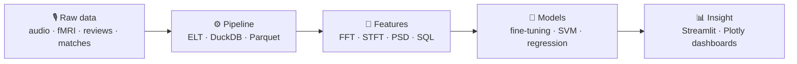

<div align="center">


<a href="https://git.io/typing-svg">
  
</a>

<p>
  
  
  
  
</p>

</div>

---

### `$ whoami`

```python
class Pittinan:
    school   = "Kasetsart University — B.Eng. Computer Engineering"
    focus    = ["Artificial Intelligence", "Machine Learning", "Data Engineering"]
    superpower = "Digital Signal Processing (FFT · STFT · PSD · Wavelets)"
    builds   = ["ELT pipelines", "star-schema warehouses", "ML models", "IoT gadgets"]
    speaks   = {"Thai": "native", "English": "fluent enough to email UK universities 😄"}

    def looking_for(self):
        return "Internship in AI / ML / Data Engineering"
```

### 🔁 How I work — from raw signal to insight



### 📈 By the numbers

<div align="center">

| 🗃️ **3.66M** | ⚽ **25,979** | 📡 **5** | 🧪 **15** | 🌏 **2** |
|:---:|:---:|:---:|:---:|:---:|
| Amazon reviews modeled into a star schema | matches merged across 9 leagues | PSD estimators written from first principles | automated data-quality checks | countries I collected a speech dataset from |

</div>

### 🚀 Featured projects

<details open>
<summary><b>🗣️ AI Builder — Native vs. Non-Native Chinese Speech</b> &nbsp;·&nbsp; <a href="https://github.com/hoggyna/AI-Builder">repo</a></summary>
<br/>

- Fine-tuned speech classification models to tell native from non-native Mandarin speakers
- Built the dataset myself by **contacting universities in China and the UK**, then handled preparation end-to-end
- Evaluated with F1, precision, recall, and accuracy

`Python` `Hugging Face Transformers` `Jupyter`
</details>

<details open>
<summary><b>🛒 Product Performance Analytics on Marketplace Data</b></summary>
<br/>

- ELT pipeline that turns **3.4 GB / 3.66M Amazon Reviews 2023** into a star schema (`fact_review`, `dim_product`, `dim_user`, `dim_date`)
- Deduplication + **15 automated data-quality checks**
- ML for rating prediction, review-sentiment consistency, and **suspicious-review detection**, served on a dashboard

`DuckDB` `Parquet` `SQL` `scikit-learn` `Streamlit` `Plotly`
</details>

<details>
<summary><b>📡 Nonparametric Spectral Estimation</b> &nbsp;·&nbsp; <a href="https://github.com/hoggyna/DSP_Project">repo</a></summary>
<br/>

- Periodogram, Welch, Bartlett, Correlogram and more, **without built-in PSD functions**
- Runtime benchmarks across signal lengths N = 2¹⁰ → 2¹⁶

`Python` `NumPy` `Matplotlib`
</details>

<details>
<summary><b>⚽ Soccer Match Prediction</b></summary>
<br/>

- Merged **25,979 matches** across 9 leagues from Kaggle + football-data.co.uk by learning team-name mappings
- Leakage-free preprocessing with **time-aware joins**

`Python` `Pandas` `SQL`
</details>

<details>
<summary><b>🧠 Brain Code Camp — fMRI Signal Classification (FFA vs. PPA)</b></summary>
<br/>

- Replicated *"Neural Differentiation of Incorrectly Predicted Memories"*
- FFT/DFT signal analysis + LinearSVC to classify brain regions

`Python` `scikit-learn` `NumPy`
</details>

<details>
<summary><b>📚 EnglishProject — vocabulary helper</b> &nbsp;·&nbsp; <a href="https://github.com/hoggyna/EnglishProject">repo</a></summary>
<br/>

- Web app I built to stop forgetting English vocabulary

`Next.js` `TypeScript`
</details>

### 🛠️ Toolbox

<div align="center">

<br/><br/>


<br/><br/>


<br/>

<sub><b>Signal processing:</b> FFT/DFT · DTFT · STFT · Z-Transform · PSD estimation · Haar DWT</sub><br/>
<sub><b>Data engineering:</b> ETL/ELT · Kimball star schema · Data warehousing · SQL / NoSQL</sub>

</div>

### 📊 Activity

<div align="center">


</div>

### 📫 Let's connect

<div align="center">

<a href="mailto:pittinan.w@ku.th"></a>
<a href="https://github.com/hoggyna"></a>

</div>


